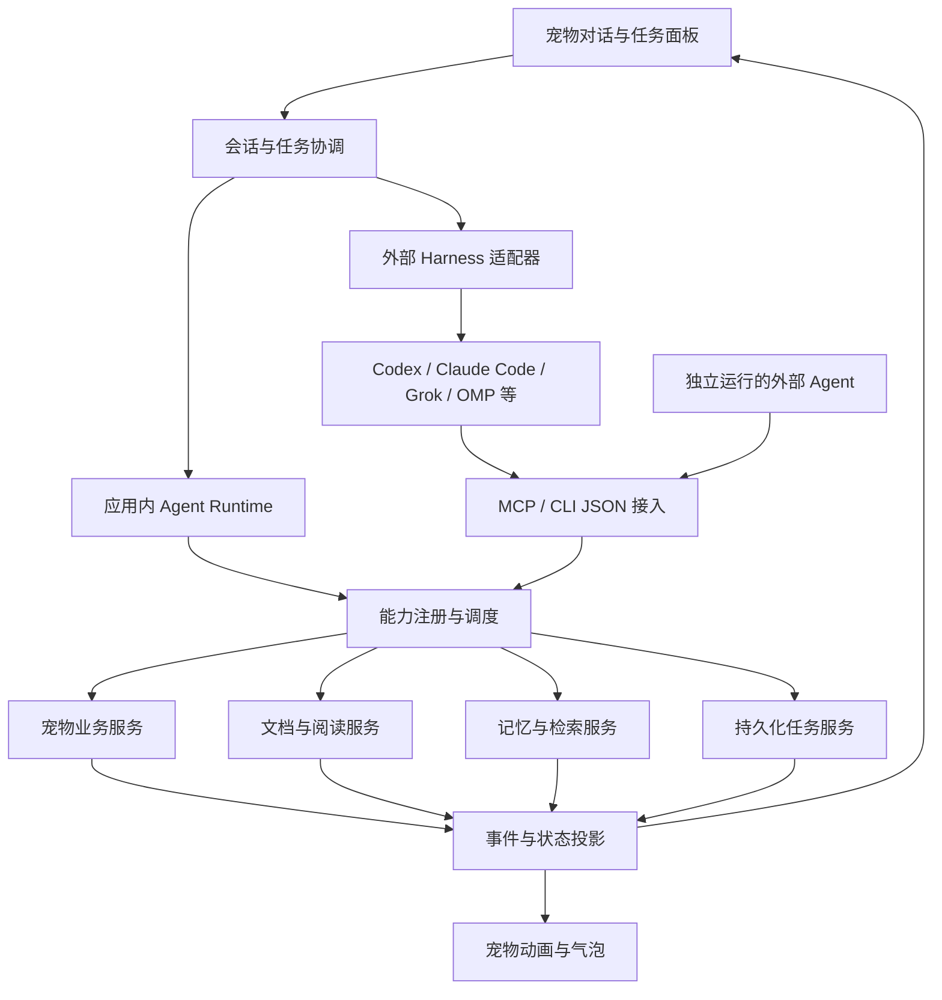

**AgentPet 重构评估 · 2026-10-16**

建议保留 Electron、TypeScript、Ruffle 和现有宠物资源，以对话、真实任务和知识记忆为新的产品中心，逐步重构业务执行层。整体属于中大型重构，主要工作集中在能力服务化、持久化任务、文档阅读、知识检索和双向 agent 接入。

本次仅新增评估文档，没有实施业务代码改动。结论来自当前源码、现有测试、本机 CLI 帮助和官方接口文档。

**已经确认的产品范围**

- 保留养成、动画、互动、背包、学习等基础能力；复杂小游戏后置。
- “读书”指读取真实书籍或文档，生成摘要，并能在后续对话中使用所学内容。
- 首期输入为本地 PDF、TXT、Markdown。PDF 首期建议明确为可提取文本的 PDF；扫描件检测后提示暂不支持，OCR 作为独立扩展。
- 应用内 agent 和外部 agent 都要支持。
- 双向接入：宠物能委派任务给 Codex、Grok Build、Claude Code、DeepSeek harness、OMP 等；这些 agent 也能调用宠物功能。
- 以下工期以本机 CLI/harness、应用运行期间提供服务为边界。远程部署、跨设备访问和应用完全退出后常驻执行尚未确认，未计入首期。

**当前代码与目标的差距**

| 模块 | 已有实现与依据 | 重构判断 |
| --- | --- | --- |
| 桌宠外壳 | `src/main/window.ts`、`desktop.ts`、`src/renderer/swf/`：透明窗口、多屏拖拽、动画、Ruffle | 保留；新增任务状态到表现层的映射 |
| 宠物养成 | `src/renderer/pet/pet.ts`、`items.ts`、`jobs.ts`：状态、道具、课程、打工 | 保留规则，抽出可直接调用的业务服务 |
| 聊天执行 | `src/renderer/ui/chat.ts:13`：文本动作词仅覆盖 FEED、CLEAN、WORK、HIDE、QUIET、NONE | 替换为结构化工具调用与执行结果回传 |
| AI 请求 | `src/shared/ai.ts:30`：一次请求返回字符串；`AiMessage` 只有三种文字角色 | 增加独立 agent 协议、流式事件、工具结果、取消与用量；原接口可继续服务短台词改写 |
| 学习 | `src/renderer/pet/jobs.ts:137`：科目、课时、属性奖励、升学考试 | 作为游戏内学习保留；真实阅读另建能力 |
| 任务 | `src/renderer/pet/activity.ts`：单槽位 work/study/trip，按成长时间推进 | 保留游戏活动语义；新增独立的后台任务系统 |
| 记忆 | `src/renderer/ui/chat.ts:80` 的 history 只存在内存，调用时截取最近 12 条消息；`pet/ai.ts` 仅记录 5 条临时事件 | 新增会话、任务记录和文档知识的持久化 |
| 状态与存档 | `src/renderer/pet/store.ts:42`：渲染层改状态，每 200 ms 批量提交；主进程保存副本 | agent 接入前统一业务状态写入权，避免内外部调用覆盖彼此 |
| 真实文档、知识检索、外部接入 | 当前源码和依赖中未发现完整实现 | 新增模块，不能直接复用游戏课程完成 |

几个会直接影响实现的细节：

1. `jobs.ts:97/144` 通过 `speak(..., { start })` 启动活动；`items.ts:48` 在动画回调中扣库存、加属性。函数返回不等于动作实际完成，动画抢占或加载失败可能使业务回调没有执行。应让业务服务提交结果后发事件，由动画消费事件；动画失败不应使工具结果失真。
2. `chat.ts` 先显示模型台词，再执行动作；缺少实际结果回传。背包无物品时，模型仍可能说已经吃完。新链路必须依据真实工具结果回答。
3. 游戏活动离线后会按时间补算，真实阅读只能按已处理的内容恢复，不能在应用关闭一小时后直接认为书已读完。
4. 暂停成长、死亡、心情耗尽会影响现有活动时钟。建议真实文档任务拥有独立生命周期，隐藏宠物或暂停养成不应自动取消阅读。
5. `pet/ai.ts` 把回复限制为短句，`chat.ts` 输入最长 200 字；摘要和追问需要完整对话面板。宠物气泡仍用于简短提醒。
6. 当前语义动画路由没有明确的 reading 动作。需盘点现有 play 片段后决定复用；首期可用现有动画配合阅读状态提示，专用读书动画另行验收。

**目标结构：一套能力，两类 agent 接入**

图中的箭头表示主要调用方向，执行结果沿相应调用返回。所有入口共享同一份任务与能力状态。

“宠物把工作交给 agent”和“agent 调用宠物功能”是不同接口：前者负责会话、流式输出、取消和后端适配；后者负责能力发现、参数校验、执行和结果。建议外部能力入口优先采用 MCP，其标准提供工具发现与调用；不支持 MCP 的 harness 再用本地 CLI JSON 或扩展适配。协议能力以目标客户端实际支持的版本为准。[MCP 架构与传输说明](https://modelcontextprotocol.io/docs/2026-07-28/learn/architecture)

应用内 runtime 自己负责模型与工具循环；采用外部 harness 时，由该 harness 负责模型循环。协调层管理任务和 UI，不重复运行另一套推理循环。

**能力层应具备的统一约定**

每个能力包含名称、说明、输入和输出 schema、可用条件、调用范围、取消语义与执行函数。它服务于明确的用户操作，无须把所有内部函数或动画帧暴露成工具。MCP 的工具定义支持输入与输出 schema；业务权限、并发控制和幂等性仍由本项目实现。[MCP 工具规范](https://modelcontextprotocol.io/specification/2025-11-25/server/tools)

| 能力组 | 首期接口示例 | 关键要求 |
| --- | --- | --- |
| 宠物查询 | `pet_get_status`、`inventory_list`、`pet_list_activities` | 返回真实状态、可用动作和限制原因 |
| 基础养成 | `pet_feed`、`pet_clean`、`pet_use_item`、`pet_interact` | 复用现有规则；提交后返回属性与库存变化 |
| 游戏活动 | `pet_study_start`、`pet_work_start`、`pet_activity_stop` | 与真实阅读区分；返回活动 ID、时长和不可执行原因 |
| 商品 | `shop_list`、`shop_buy` | 校验数量、价格、余额和等级；以明确的消费授权范围执行 |
| 文档 | `document_import`、`document_list`、`document_get_excerpt` | 以文档 ID 和来源位置访问内容；文件导入受用户选择或授权目录约束 |
| 阅读 | `reading_start`、`reading_get_result` | 返回任务 ID；支持摘要、重点提取等明确目标 |
| 记忆 | `knowledge_search`、`knowledge_get_source`、`knowledge_forget` | 跨会话检索、来源引用、删除后不再检索 |
| 任务 | `task_get`、`task_list`、`task_cancel`、`task_resume` | 内外部 agent 与 UI 看到同一状态；恢复能力按后端支持情况提供 |
| 桌宠偏好 | `pet_set_visibility`、`pet_set_quiet` | 使用语义接口，保持现有桌面行为 |

保留的治疗、升学考试、装扮等操作也应进入能力清单。需要用户选择的步骤返回 `waiting_input` 和可执行选项，不能只打开一个窗口就宣称完成；考试应提供题目、提交答案和结果接口，不绕过原规则。复杂小游戏按后续模块逐步接入，首期不承诺自动游玩。

即时操作返回 `succeeded` 或结构化错误；耗时操作返回 `accepted + taskId`。统一错误码应覆盖物品不足、活动冲突、文件不可读、模型不可用、后端不支持和用户取消。外部调用不直接开放 `save(patch)`，也不能直接写游戏数据库。

同一宠物的资源修改串行提交；重复请求以 `requestId` 去重。单个工具效果提交与请求记录应在同一事务或可恢复提交边界内完成，避免重试重复扣费、扣道具或发奖励。读取、解析和检索可以按额度并行。

**“读这本书，并记住它”的完整体验**

1. 用户拖入文档或选择文件，再说“读这本书，总结重点，以后聊到时能想起来”。已有同名文档时根据当前附件、文档 ID 或必要的澄清确定对象。
2. 文档服务导入并记录内容哈希、版本、格式与来源，提取文本，建立页码或段落锚点。文本 PDF 保留页码；TXT/Markdown 使用段落、行号或标题路径。加密、损坏、扫描件或超限文件返回明确状态。
3. 创建 `reading` 任务。宠物显示阅读状态；任务卡显示“正在解析 / 阅读第几部分 / 整理摘要 / 保存知识”，允许取消。进度来自实际阶段和已处理片段数量。
4. 选定内置 runtime 或某个外部 harness。应用负责分段、覆盖范围、检查点和输出结构；后端处理分段总结与综合回答，不能仅凭一句“读完了”认定任务成功。
5. 保存分段摘要、整体摘要、关键概念及引用，记录文档版本、读取覆盖范围和未处理部分。多栏 PDF 的提取顺序需要质量检查；内容不足时明确报告，不伪造全文理解。
6. 宠物气泡提示“我读完了，整理好了重点”，完整结果显示在对话或笔记面板，并能打开对应页或段落。
7. 用户之后问“上次那本书对这个问题怎么说”，先检索文档知识，再用相关原文和摘要回答并附来源。更换 agent 后端后仍能使用这些知识。

这里的“记住”是本地持久化知识加检索，不是修改模型参数，也不是一直把整本书放在提示词里。首期建议保留原文片段、摘要和词法全文检索接口，单独评估中文检索质量；向量检索可按同义表达和跨文档问答的验收结果增加，不先绑定特定向量数据库。

会话记录、书籍知识、用户明确表达的偏好分别存储。文档中的命令性文字只是阅读材料，不能提升为系统指令或调用授权。知识项保存出处；删除文档时应同步处理摘要与索引，并让用户明确了解历史聊天副本是否一并删除。

**外部 harness 接入评估**

| 后端 | 本次确认的入口 | 建议接法与尚未验证的部分 |
| --- | --- | --- |
| Codex | 本机 `codex app-server --help` 显示 stdio 接口；官方文档提供会话、事件和中断机制 | 优先作为第一个委派后端，采用 app-server 适配；实际鉴权、恢复、取消和宠物工具回调仍需联调。本机帮助标注实验性，需固定并验证版本 |
| Claude Code | 官方文档提供程序化运行、JSON/流式 JSON 和 MCP | 第二个适配器候选，按需要选择 Agent SDK 或结构化 CLI；交互授权与取消必须适配，不能只抓终端文字 |
| Grok Build | 本机 `grok --help`、`grok agent --help` 确认无界面运行、stdio、结构化流输出；`grok mcp --help` 确认 MCP 配置入口 | 原生协议或结构化 CLI 适配；具体事件、工具回调、恢复与取消需要协议探针和实际验证 |
| OMP | 本机 v18.11.0 帮助显示 `--mode json/rpc/rpc-ui`、非交互运行和会话恢复 | 优先验证 RPC；本次未确认 MCP 接入细节，可保留扩展或 CLI JSON 工具桥方案 |
| DeepSeek harness | 当前未得到确切仓库、命令或版本；PATH 中未发现 `deepseek` 命令 | 先明确实现再做探针；不能把某个模型的 API 兼容性当作 harness 的会话、工具或 MCP 兼容性 |

Codex 的具体接入依据为 [官方 App Server 文档](https://learn.chatgpt.com/docs/app-server) 和 [MCP 配置文档](https://learn.chatgpt.com/docs/extend/mcp?surface=cli)；Claude Code 依据为 [程序化运行文档](https://code.claude.com/docs/en/headless) 和 [MCP 文档](https://code.claude.com/docs/en/mcp)。本次只查询帮助和文档，没有启动模型推理或验证账户可用性。

适配器统一输出会话开始、文字增量、工具开始/结束、等待输入、等待授权、用量、完成、失败、取消事件，并声明是否支持流式、恢复、中断和工具接入。不能要求每个后端提供不存在的功能；UI 按能力显示可用操作。

每个宠物会话绑定明确的后端会话 ID，恢复时不使用“恢复最近一个会话”这类含糊操作。后端私有会话可以保留，但知识与任务结果由 AgentPet 持有。更换后端时用任务摘要和知识引用重建上下文，不承诺不同厂商原生会话可无损转换。

每个任务记录 `rootTaskId`、`parentTaskId`、来源和后端。委派给外部 agent 的会话只获得完成任务所需工具；默认不向它继续开放无限制委派入口，避免“宠物委派给 agent，agent 再委派回宠物”的循环。

本机接入建议采用一个应用侧能力宿主，MCP 和 CLI 只是桥接到该宿主。宿主保持单实例；各客户端不各自启动一份可写宠物状态。若使用本地 HTTP，限制 loopback、验证来源并使用客户端凭据；若使用 stdio 桥，桥通过受控本地 IPC 连接宿主。不自动改写用户已有 agent 的全局配置。

**进程、数据和 UI 的改动边界**

- 渲染层：宠物动画、对话、任务卡、书架/笔记和交互事件。
- 主进程：窗口生命周期、凭据访问、能力调度、状态提交、任务协调和进程管理。
- 工作进程：文档解析、索引等重任务。Electron 的 utility process 可以承载 Node 环境中的耗时或易失败组件，建议通过消息调用，避免阻塞 UI 与主进程。[Electron 进程模型](https://www.electronjs.org/docs/latest/tutorial/process-model)
- Harness 子进程：由后端适配器启动，记录 PID 与子进程归属，支持中断和完整清理；不能误停用户独立启动的 agent。

建议新增 `src/core/pet/`、`src/core/tools/`、`src/core/tasks/`、`src/core/documents/`、`src/core/memory/`、`src/core/agent/`；在 `src/main/` 放桌面与进程适配，在 `src/preload/` 定义收窄的桥，在渲染层提供会话和状态投影。具体目录可按实施时的体量调整。

旧 `save.json` 继续承载宠物兼容存档。会话、文档元数据、任务、知识和执行记录建议使用独立本地数据库，例如经目标 Electron 版本验证的 SQLite 实现；文档和解析产物放独立目录。不要把整本书或全部聊天历史塞进每次重写的宠物 JSON。数据库方案需要验证打包、事务、迁移和中文检索，不在本评估中锁定库版本。

当前 `settings.aiKey` 随存档加载到渲染层，导出也会包含。接入层重构时应把凭据移到主进程管理的独立存储，导出默认排除凭据；外部 harness 通过其支持的登录方式使用身份，不复制用户密钥到宠物知识或对话记录。文档使用云模型处理时，界面应说明所选后端会接收文档片段。

迁移顺序应是：先抽纯业务服务并让 UI 使用统一命令，再移交核心状态写入权，最后开放外部可写入口。迁移期间只保留一个权威写入口；未迁移的模块通过受控适配提交更新，不能保留渲染层和主进程两套可独立覆盖的状态。共享余额、库存和任务进度的模块必须统一校验与提交。

首期继续运行于当前桌面应用内：关闭聊天面板不会中断阅读；完全退出应用时保存检查点并停止本任务进程，下次启动恢复可恢复的部分。任务至少区分 queued、running、waiting_input、waiting_approval、interrupted、succeeded、failed、cancelled。HTTP/CLI 进程返回成功不代表文档任务已成功；需要校验产物、覆盖范围和引用后再提交完成状态。

**实施顺序与工作量**

以下是代码审阅后的粗估，按一位熟悉 TypeScript/Electron 的工程师计算，不是交付承诺；包含必要回归，不包括新美术、OCR、远程常驻服务和复杂小游戏改造。

| 阶段 | 可验收结果 | 估算 |
| --- | --- | --- |
| 0：契约与探针 | 保留功能清单、工具/任务/后端事件契约；第一个 harness 的启动、事件、取消和工具回调验证 | 2–3 人日 |
| 1：基础能力解耦 | 核心状态单一写入口；喂养、清洁、背包、学习/打工等调用返回确定结果；UI 走同一业务入口 | 5–8 人日 |
| 2：对话与真实阅读 | 内置 agent 工具循环、持久化任务、TXT/Markdown/文本 PDF、摘要、引用、跨会话问答、任务卡 | 8–12 人日 |
| 3：双向接入 | MCP 能力服务、一个参考 harness（建议 Codex）、双向工具调用、事件和会话归属、取消与进程清理 | 5–8 人日 |
| 4：完整回归 | 存档升级、异常恢复、幂等/竞争、阅读质量样本、Windows/macOS 打包与验证 | 4–6 人日 |

核心版本合计约 **24–37 人日，按每周 5 个工作日约 5–8 周**。阶段 2 和 3 可按一条真实阅读链路交错推进，但不应省略基础状态边界。最早可演示的切片是“导入一份 Markdown → 宠物创建阅读任务 → 一个后端生成有引用的摘要 → 关闭并重开后仍能追问”。

在统一协议已稳定、目标 harness 有可用程序化接口的前提下，Claude Code、Grok Build、OMP 每个完整适配暂按额外 2–5 人日估算；三者都交付时总量约 30–52 人日。DeepSeek harness 待确认实现后单独估算。接口兼容、授权等待、取消、恢复和两个桌面平台的打包差异是主要不确定项。

优先级建议：先贯通真实阅读、记忆和一个双向后端；然后接入更多 harness、完善治疗/考试等较复杂能力；最后处理社区、农场、小游戏和 OCR 等扩展。复杂玩法保留源代码和资源，入口如何收纳在实施 UI 时确定。

**必须通过的验收场景**

1. 无 AI、无网络时，保留的基础桌宠功能仍能使用，旧存档能加载和导出。
2. UI、内置 agent 和外部工具调用同一喂养/学习能力，结果及限制一致；库存不足、正在忙、重复请求都有确定结果。
3. 文档导入后确实处理文本并生成带来源的摘要；损坏文件、扫描件、空文档、超限文件和解析失败不能显示“读完”。
4. 应用重启或切换后端后仍可检索已读文档；回答引用对应版本的页码/段落，找不到内容时明确说明。
5. 阅读中关闭面板、隐藏宠物、暂停养成不丢任务；完全退出后按检查点恢复，不按离线时长虚构完成。
6. UI 和 agent 同时操作时不重复扣物品、不覆盖状态；模型请求重试、事件重复和结果回传失败不会重复提交副作用。
7. 宠物能向参考 harness 委派任务；独立启动的外部 agent 也能通过同一能力服务查询状态、启动阅读、检索记忆和取消任务。
8. 后端未登录、工具不支持、等待授权、网络中断和子进程崩溃能反映为任务状态；取消后不继续写入迟到结果。
9. 文档中的诱导命令不触发无关工具；删除知识后不再从其索引中召回；普通工具不访问未授权文件或改写存档结构。
10. 退出和测试结束时关闭本任务创建的 harness、worker、MCP 桥、浏览器与开发服务进程；用户独立会话保持不受影响。

本次基线验证：`npm test` **17/17 通过**，`npm run typecheck` **通过**。测试主要覆盖存档、桌面辅助逻辑和资源，尚不覆盖上述 agent/阅读能力；本次没有执行新的真实 Electron 回归或模型调用。
