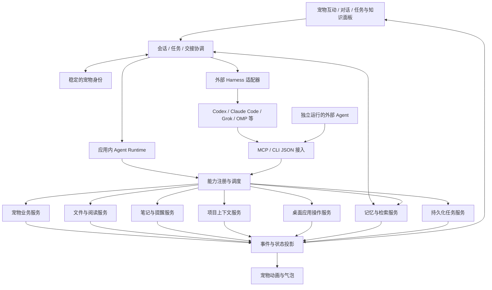

# AgentPet 重构评估

初评日期：2026-10-16。产品范围与实现状态更新：2026-10-21。

保留 Electron、TypeScript、Ruffle 和现有宠物资源，产品定位调整为“有持续性格和记忆的桌面伙伴，能够自己完成任务，也能组织其他 Agent 一起工作”。互动、自身 Agent 和外部协作共同构成实施主线；真实阅读作为文件与知识技能接入。完整需求、编号和验收目标见 [产品需求](product-requirements.md)。

本次只更新文档，未实施新功能或重跑测试。当前状态依据源码及 2026-10-16 基础重构、2026-10-20 资源清理记录；外部接口调查保留初评时的证据，不代表本次重新验证了客户端或账户。

**已经确认的产品范围**

- 陪伴、聊天和互动是日常体验中心；名字、性格、用户偏好和共同经历随应用持久化，切换后端后保持连续。
- 宠物具有自己的 Agent 工具循环，能够理解目标、执行步骤、检查结果和处理失败；应用内与外部 Agent 都要支持。
- 笔记与提醒、文件查找整理、项目理解与方案讨论、桌面应用操作全部纳入必须实现的本体能力，分期只决定先后顺序。
- 双向接入：宠物能委派任务给 Codex、Grok Build、Claude Code、DeepSeek harness、OMP 等目标后端；这些 Agent 也能调用宠物功能。具体实现和版本逐项适配验证。
- 同时支持在具备恢复能力的原后端接续指定会话，以及通过目标、决定、进度、产物和待办进行跨后端交接。
- 保留养成、动画、互动、背包、学习等基础能力，复杂小游戏后置。游戏状态与 Agent 工作生命周期独立，游戏操作继续遵守原规则。
- 真实阅读保留 TXT、Markdown、文本 PDF、摘要和来源引用需求；扫描件检测后说明限制，OCR 作为独立扩展。
- 主动聊天、任务进度、定时提醒和主动建议分别配置；长结果在面板展示，气泡用于简短互动。
- 轻量化、运行时低占用和高性能是全部功能的交付约束；技能按需加载、执行器按任务启用，并行工作和缓存有明确预算，各阶段同时验收功能与性能。
- 当前接入设计以本机应用与 CLI/harness 为基础。远程部署、跨设备访问、完全退出后的提醒与常驻执行方案仍待明确，不因加入提醒需求自动视为已承诺。

**当前代码与目标的差距**

| 模块 | 已有实现与依据 | 重构判断 |
| --- | --- | --- |
| 桌宠外壳 | `src/main/window.ts`、`desktop.ts`、`src/renderer/swf/`：透明窗口、多屏拖拽、动画、Ruffle | 保留；新增任务状态到表现层的映射 |
| 宠物养成 | `src/core/pet/` 已抽出物品、购买、治疗、互动、学习打工和考试规则；渲染层 `commands.ts` 统一提交 | 纯业务拆分已完成一部分；继续迁移成长、活动和共享状态的权威写入 |
| 聊天执行 | `src/renderer/ui/chat.ts` 仅返回文字，旧动作词执行和作弊口令已移除 | 新增结构化工具调用、真实结果回传、长对话与附件；不恢复文本动作口令 |
| AI 请求 | `src/shared/ai.ts:30`：一次请求返回字符串；`AiMessage` 只有三种文字角色 | 增加独立 agent 协议、流式事件、工具结果、取消与用量；原接口可继续服务短台词改写 |
| 学习与游戏活动 | `src/core/pet/activities.ts` 和渲染层适配保留 work/study、课时与考试；旅行已归档 | 保留游戏活动语义；真实阅读和工作另建任务系统 |
| 记忆与身份 | `src/renderer/ui/chat.ts` 的 history 只在内存中，调用时截取最近 12 条消息；`pet/ai.ts` 仅记录 5 条临时事件 | 新增稳定的身份配置、个人偏好、共同经历、项目知识与会话/任务持久化 |
| 状态与存档 | `src/renderer/pet/store.ts` 在渲染层改状态，每 200 ms 批量提交；主进程仓库原子落盘 | 开放外部写入口前完成单一权威状态、持久化请求去重和可靠提交结果 |
| 凭据 | 导出已清空 `settings.aiKey`；本地存档和渲染层配置仍包含该字段 | 导出排除已完成；主进程独立凭据存储仍待迁移 |
| 本体工作技能 | 笔记提醒、文件阅读整理、项目协作、通用桌面应用操作尚未实现 | 通过统一工具和任务服务新增；旧日期问候、游戏课程及窗口控制不能替代这些能力 |
| 外部接入与接续 | 尚无 MCP 能力服务、harness 适配器和持久化工作交接记录 | 新增双向调用、指定会话恢复、跨后端上下文交接和兼容矩阵 |
| 资源 | 2026-10-20 已按依赖清理为 3,673 个文件、98.1 MiB；原创熊猫替换尚未开始 | 复用现有资源先验证互动与工作状态；新美术独立规划 |
| 运行性能 | 已有资源瘦身和功能测试；尚无完整进程组的 CPU、内存、GPU、启动和长期驻留基线 | 建立生产构建基准与预算，测量透明窗口、轮询、播放器、持久化和新增执行器开销 |

几个会直接影响实现的细节：

1. 喂食、清洁、治疗和学习打工已脱离动画回调提交效果，动画失败不撤销业务结果。`command()` 的成功目前仍是渲染层提交结果，没有等待主进程持久化确认；对外工具成功需要明确可靠提交边界。
2. 聊天已停止执行文字动作词。新 Agent 链路需要新增模型与工具循环，根据真实结果回答，并区分自身执行与外部委派的工作归属。
3. 游戏活动支持离线补算，真实工作按检查点、已处理内容和实际产物恢复；提醒按触发时间和投递记录恢复。三者不能共享一套完成判定。
4. 暂停成长、死亡或心情耗尽继续影响游戏规则，但不阻塞项目任务、知识查询和外部协作；隐藏宠物或关闭面板也不自动取消任务。
5. `pet/ai.ts` 限制短句，`chat.ts` 输入最长 200 字；项目讨论、摘要、附件和追问需要完整面板。身份与记忆保持一致，完整结果不能继续使用气泡截断规则。
6. 当前语义动画路由没有明确的 reading 动作。首期可复用现有动画配合思考、工作、等待和完成提示，专用动作另行验收；显示状态来自执行事件。
7. 桌面应用操作需要平台、应用和流程兼容清单及结果核验。现有拖拽、置顶和全屏检测只管理桌宠自身窗口，不能直接视为通用电脑操作能力。

**目标结构：一套能力，两类 agent 接入**

图中的箭头表示主要调用方向，执行结果沿相应调用返回。所有入口共享同一份任务与能力状态。

“宠物把工作交给 agent”和“agent 调用宠物功能”是不同接口：前者负责会话、流式输出、取消和后端适配；后者负责能力发现、参数校验、执行和结果。建议外部能力入口优先采用 MCP，其标准提供工具发现与调用；不支持 MCP 的 harness 再用本地 CLI JSON 或扩展适配。协议能力以目标客户端实际支持的版本为准。[MCP 架构与传输说明](https://modelcontextprotocol.io/docs/2026-07-28/learn/architecture)

应用内 runtime 自己负责模型与工具循环；采用外部 harness 时，由该 harness 负责模型循环。协调层管理任务和 UI，不重复运行另一套推理循环。

身份、记忆和公共任务记录归 AgentPet 管理。接续既包括后端支持的原会话恢复，也包括跨后端的工作上下文交接。目标、约束、决定、产物、待办及执行记录沿任务传递，具体数据归属见 [产品需求](product-requirements.md)。

**能力层应具备的统一约定**

每个能力包含名称、说明、输入和输出 schema、可用条件、调用范围、取消语义与执行函数。它服务于明确的用户操作，无须把所有内部函数或动画帧暴露成工具。MCP 的工具定义支持输入与输出 schema；业务权限、并发控制和幂等性仍由本项目实现。[MCP 工具规范](https://modelcontextprotocol.io/specification/2025-11-25/server/tools)

以下名称为契约设计示例，具体工具集合在 M0 探针和接口设计时确定。

| 能力组 | 接口示例 | 关键要求 |
| --- | --- | --- |
| 宠物查询 | `pet_get_status`、`inventory_list`、`pet_list_activities` | 返回真实状态、可用动作和限制原因 |
| 基础养成 | `pet_feed`、`pet_clean`、`pet_use_item`、`pet_interact` | 复用现有规则；提交后返回属性与库存变化 |
| 游戏活动 | `pet_study_start`、`pet_work_start`、`pet_activity_stop` | 与真实阅读区分；返回活动 ID、时长和不可执行原因 |
| 商品 | `shop_list`、`shop_buy` | 校验数量、价格、余额和等级；以明确的消费授权范围执行 |
| 笔记与待办 | `note_create`、`note_search`、`note_update`、`todo_complete` | 持久化、关联会话/项目、可纠正；创建重试不产生重复记录 |
| 提醒 | `reminder_create`、`reminder_list`、`reminder_update`、`reminder_cancel` | 明确时间、时区、重复和漏提醒策略；以投递记录去重，展示退出后的运行边界 |
| 文件整理 | `file_search`、`file_read`、`file_plan_changes`、`file_apply_changes` | 受指定目录范围约束；处理冲突和版本变化，核对实际结果，提供操作记录与恢复边界 |
| 项目 | `project_inspect`、`project_record_decision`、`project_get_context` | 关联项目范围、依据、决定和待办；为委派提供明确目标与验收要求 |
| 桌面应用 | `desktop_list_apps`、`desktop_observe`、`desktop_act` | 按平台和应用声明支持范围；定位目标、读取操作后状态，不以输入事件发送成功替代结果验证 |
| 文档 | `document_import`、`document_list`、`document_get_excerpt` | 以文档 ID 和来源位置访问内容；文件导入受用户选择或授权目录约束 |
| 阅读 | `reading_start`、`reading_get_result` | 返回任务 ID；支持摘要、重点提取等明确目标 |
| 记忆 | `knowledge_search`、`knowledge_get_source`、`knowledge_forget` | 跨会话检索、来源引用、删除后不再检索 |
| 任务 | `task_get`、`task_list`、`task_cancel`、`task_resume` | 内外部 agent 与 UI 看到同一状态；恢复能力按后端支持情况提供 |
| 委派与交接 | `agent_list`、`agent_delegate`、`task_handoff` | 明确后端与会话 ID、父子任务关系、交接包和执行记录；防止递归委派和副作用重放 |
| 桌宠偏好 | `pet_set_visibility`、`pet_set_quiet` | 使用语义接口，保持现有桌面行为 |

保留的治疗、升学考试、装扮等操作也应进入能力清单。需要用户选择的步骤返回 `waiting_input` 和可执行选项，不能只打开一个窗口就宣称完成；考试应提供题目、提交答案和结果接口，不绕过原规则。复杂小游戏按后续模块逐步接入，首期不承诺自动游玩。

即时操作返回 `succeeded` 或结构化错误；耗时操作返回 `accepted + taskId`。统一错误码应覆盖物品不足、活动冲突、文件不可读、模型不可用、后端不支持和用户取消。外部调用不直接开放 `save(patch)`，也不能直接写游戏数据库。

同一宠物的资源修改串行提交；重复请求以 `requestId` 去重。单个工具效果提交与请求记录应在同一事务或可恢复提交边界内完成，避免重试重复扣费、扣道具或发奖励。读取、解析和检索可以按额度并行。

文件、桌面和外部系统的副作用未必能加入本地数据库事务，需要操作记录、检查点和执行后核对。无法判断是否已执行时先检查实际状态，不能把网络重试直接等同于可安全重复执行。

**“读这本书，并记住它”的完整体验**

这是 R04/R09 的技能验收场景。完整产品主线还包括陪伴互动、自身工具执行、项目讨论、笔记提醒、桌面操作和外部协作，联合场景见 [产品需求](product-requirements.md)。

1. 用户拖入文档或选择文件，再说“读这本书，总结重点，以后聊到时能想起来”。已有同名文档时根据当前附件、文档 ID 或必要的澄清确定对象。
2. 文档服务导入并记录内容哈希、版本、格式与来源，提取文本，建立页码或段落锚点。文本 PDF 保留页码；TXT/Markdown 使用段落、行号或标题路径。加密、损坏、扫描件或超限文件返回明确状态。
3. 创建 `reading` 任务。宠物显示阅读状态；任务卡显示“正在解析 / 阅读第几部分 / 整理摘要 / 保存知识”，允许取消。进度来自实际阶段和已处理片段数量。
4. 选定内置 runtime 或某个外部 harness。应用负责分段、覆盖范围、检查点和输出结构；后端处理分段总结与综合回答，不能仅凭一句“读完了”认定任务成功。
5. 保存分段摘要、整体摘要、关键概念及引用，记录文档版本、读取覆盖范围和未处理部分。多栏 PDF 的提取顺序需要质量检查；内容不足时明确报告，不伪造全文理解。
6. 宠物气泡提示“我读完了，整理好了重点”，完整结果显示在对话或笔记面板，并能打开对应页或段落。
7. 用户之后问“上次那本书对这个问题怎么说”，先检索文档知识，再用相关原文和摘要回答并附来源。更换 agent 后端后仍能使用这些知识。

这里的“记住”是本地持久化知识加检索，不是修改模型参数，也不是一直把整本书放在提示词里。首期建议保留原文片段、摘要和词法全文检索接口，单独评估中文检索质量；向量检索可按同义表达和跨文档问答的验收结果增加，不先绑定特定向量数据库。

会话记录、书籍知识、用户明确表达的偏好和共同经历分别存储，支持查看、纠正和遗忘。文档中的命令性文字只是阅读材料，不能提升为系统指令或调用授权。知识项保存出处；删除文档时同步处理摘要、索引和相关运行任务，防止迟到结果恢复已删除知识，并让用户明确了解历史聊天副本是否一并删除。

**外部 harness 接入评估**

以下为 2026-10-16 初评记录，2026-10-21 文档更新未重新执行 CLI 探针或验证外部接口。实施时需确认具体版本及能力。

| 后端 | 初评时确认的入口 | 建议接法与尚未验证的部分 |
| --- | --- | --- |
| Codex | 本机 `codex app-server --help` 显示 stdio 接口；官方文档提供会话、事件和中断机制 | 优先作为第一个委派后端，采用 app-server 适配；实际鉴权、恢复、取消和宠物工具回调仍需联调。本机帮助标注实验性，需固定并验证版本 |
| Claude Code | 官方文档提供程序化运行、JSON/流式 JSON 和 MCP | 第二个适配器候选，按需要选择 Agent SDK 或结构化 CLI；交互授权与取消必须适配，不能只抓终端文字 |
| Grok Build | 本机 `grok --help`、`grok agent --help` 确认无界面运行、stdio、结构化流输出；`grok mcp --help` 确认 MCP 配置入口 | 原生协议或结构化 CLI 适配；具体事件、工具回调、恢复与取消需要协议探针和实际验证 |
| OMP | 本机 v18.11.0 帮助显示 `--mode json/rpc/rpc-ui`、非交互运行和会话恢复 | 优先验证 RPC；本次未确认 MCP 接入细节，可保留扩展或 CLI JSON 工具桥方案 |
| DeepSeek harness | 当前未得到确切仓库、命令或版本；PATH 中未发现 `deepseek` 命令 | 先明确实现再做探针；不能把某个模型的 API 兼容性当作 harness 的会话、工具或 MCP 兼容性 |

初评时 Codex 的接入依据为 [官方 App Server 文档](https://learn.chatgpt.com/docs/app-server) 和 [MCP 配置文档](https://learn.chatgpt.com/docs/extend/mcp?surface=cli)；Claude Code 依据为 [程序化运行文档](https://code.claude.com/docs/en/headless) 和 [MCP 文档](https://code.claude.com/docs/en/mcp)。当时只查询帮助和文档，没有启动模型推理或验证账户可用性。

适配器统一输出会话开始、文字增量、工具开始/结束、等待输入、等待授权、用量、完成、失败、取消事件，并声明是否支持流式、恢复、中断和工具接入。不能要求每个后端提供不存在的功能；UI 按能力显示可用操作。

每个宠物会话绑定明确的后端会话 ID，恢复时不使用“恢复最近一个会话”这类含糊操作。后端私有会话可以保留，但知识与任务结果由 AgentPet 持有。更换后端时用任务摘要和知识引用重建上下文，不承诺不同厂商原生会话可无损转换。

交接包还需包含项目范围、用户目标与约束、关键决定、已完成步骤、产物及版本、剩余工作、未解决问题和工具执行记录。恢复前核对原会话、产物和副作用；不支持原生恢复时明确提供上下文交接或重新执行，不能显示无效的“继续”操作。更换执行者保持宠物身份，并保留任务来源与工作归属。

每个任务记录 `rootTaskId`、`parentTaskId`、来源和后端。委派给外部 agent 的会话只获得完成任务所需工具；默认不向它继续开放无限制委派入口，避免“宠物委派给 agent，agent 再委派回宠物”的循环。

本机接入建议采用一个应用侧能力宿主，MCP 和 CLI 只是桥接到该宿主。宿主保持单实例；各客户端不各自启动一份可写宠物状态。若使用本地 HTTP，限制 loopback、验证来源并使用客户端凭据；若使用 stdio 桥，桥通过受控本地 IPC 连接宿主。不自动改写用户已有 agent 的全局配置。

**进程、数据和 UI 的改动边界**

- 渲染层：宠物动画与互动、完整对话、任务卡、笔记提醒、书架、项目与记忆管理；主动聊天和工作通知分别配置。
- 主进程：窗口生命周期、凭据访问、能力调度、状态提交、任务与交接协调、提醒调度和进程管理。
- 工作进程：文档解析、索引等重任务。Electron 的 utility process 可以承载 Node 环境中的耗时或易失败组件，建议通过消息调用，避免阻塞 UI 与主进程。[Electron 进程模型](https://www.electronjs.org/docs/latest/tutorial/process-model)
- Harness 子进程：由后端适配器启动，记录 PID 与子进程归属，支持中断和完整清理；不能误停用户独立启动的 agent。

`src/core/pet/` 已存在。建议新增工具、任务、身份与记忆、Agent、笔记提醒、文件阅读及项目上下文业务模块；在 `src/main/` 放桌面应用、文件系统和进程适配，在 `src/preload/` 定义收窄的桥，在渲染层提供会话和状态投影。具体目录按实施体量确定，避免每种后端重复实现技能。

旧 `save.json` 继续承载宠物兼容存档。身份、会话、笔记提醒、文档元数据、任务、知识、交接和执行记录建议使用独立本地数据库，例如经目标 Electron 版本验证的 SQLite 实现；文档和解析产物放独立目录。不要把整本书或全部聊天历史塞进每次重写的宠物 JSON。数据库方案需要验证打包、事务、迁移和中文检索，不在本评估中锁定库版本。备份、遗忘、宠物重生时的保留策略应明确覆盖两类存储。

当前导出已经清空 `settings.aiKey`，但本机存档和渲染层配置仍包含该字段。接入层重构时还需把凭据移到主进程管理的独立存储；外部 harness 通过其支持的登录方式使用身份，不复制用户密钥到宠物知识或对话记录。文档使用云模型处理时，界面应说明所选后端会接收文档片段。

迁移顺序应是：先抽纯业务服务并让 UI 使用统一命令，再移交核心状态写入权，最后开放外部可写入口。迁移期间只保留一个权威写入口；未迁移的模块通过受控适配提交更新，不能保留渲染层和主进程两套可独立覆盖的状态。共享余额、库存和任务进度的模块必须统一校验与提交。

当前按桌面应用内运行设计：关闭聊天面板或隐藏宠物不会中断工作；完全退出应用时保存检查点并停止本任务进程，下次启动恢复可恢复的部分。任务至少区分 queued、running、waiting_input、waiting_approval、interrupted、succeeded、failed、cancelled。HTTP/CLI 返回成功、鼠标键盘事件发送成功都不等于任务完成；需要校验对应产物、应用状态或阅读覆盖范围和引用。

提醒单独定义时区、重复规则、休眠唤醒、错过时间和投递去重。完全退出后由系统调度提醒还是需要常驻服务尚未确定，不能把该能力隐含在应用内定时器承诺中。桌面操作的首批应用与流程、主动互动的默认频率、模型与并发额度等参数见 [产品需求的待定项](product-requirements.md)。

**轻量化与性能约束**

N01–N07 与全部功能并行实施，具体初始预算和基准方法见 [轻量化与性能要求](performance-requirements.md)。M0 先建立固定设备上的性能基线，后续每个能力都报告常驻、活动及回收后的资源成本。

- 常驻宠物和轻量调度；解析器、桌面操作及外部后端按需启用，默认不加载本地大模型或启动所有后端。
- 重任务使用有界队列和 worker；前台交互与取消优先，状态与流式输出增量更新，缓存、日志及临时文件设上限。
- 可见、静态、隐藏和锁屏分别控制绘制与观察频率；降低展示成本不暂停工作任务、提醒或必要持久化。
- 测量完整应用进程组，外部 harness 与本地模型单列并报告合计。资源移到子进程不能被计为开销消失。
- 先测量当前工作区大小透明窗口、33 ms 光标轮询、12 Hz 动作检查、双播放器和同步存档写入；这些是待测位置，不是已确认的瓶颈。

现阶段保留 Electron + Ruffle 建立基线；若优化后仍无法满足冻结预算，再以同一场景验证替代窗口、渲染或外壳方案。保留完整功能、任务恢复和交互质量，不以削减需求取得性能数字。

**实施顺序与工作量**

实施顺序与 [产品需求](product-requirements.md) 对齐。基础玩法收敛、部分纯业务拆分和资源清理已完成，但不能据此把原“基础能力解耦”阶段整体标为完成。

| 里程碑 | 可验收结果 | 当前差距 |
| --- | --- | --- |
| M0：统一基础与协议 | 权威状态托管、工具契约、持久化任务与记忆、身份配置、可靠提交、后端探针和性能基线 | 复用纯业务函数；新增状态托管、持久化去重和数据库，并冻结性能场景与预算 |
| M1：核心互动与协作 | 完整对话、自身 Agent、任务面板、参考后端双向调用及接续 | 真实任务可执行、反馈、取消和恢复；同时检查核心常驻成本与交互延迟 |
| M2：全部本体技能 | 笔记提醒、文件阅读整理、项目协作、支持范围内的桌面操作 | R03–R06 均需新增，联合场景贯通；测工作时响应、并发限制和资源回收 |
| M3：扩展与交接完善 | 更多后端与应用、跨后端交接、记忆管理和主动行为 | 建立兼容矩阵，验证数据连续、异常恢复和多执行器组合总成本 |
| M4：完整发布验证 | 数据迁移、幂等、技能质量、长期性能、包体和跨平台验证 | 覆盖 R01–R09 与 N01–N07；现有功能回归不能替代新功能和性能结果 |

各里程碑持续执行功能与性能回归。早期先验证“聊天与互动 → 自身调用工具 → 委派给一个外部 Agent → 展示真实进度与结果 → 重启后接续”，随后贯通全部本体技能。文件阅读仍保留“导入 Markdown → 有引用的摘要 → 重启后追问”的独立验收，但不再代表整个产品主线。

2026-10-16 的历史粗估为旧核心范围 24–37 人日；每个追加后端 2–5 人日，三个追加后端全部交付时约 30–52 人日。这些数字不含本轮完整笔记提醒、文件整理、项目协作、通用桌面操作及接续范围，也未扣除后来已完成的基础重构，**不能作为当前剩余工期或新范围的交付承诺**。

新估算应在参考后端探针、桌面应用流程清单、提醒退出方案、存储边界及性能基线确定后按里程碑重新拆分，包含性能整改与长期回归。DeepSeek harness 仍需先明确具体实现。原创美术、OCR、远程常驻和复杂小游戏单独评估；归档源码保留，已删除玩法资源需要从历史恢复或另行制作。

**必须通过的验收场景**

以下场景对应 [产品需求](product-requirements.md) 的 R01–R09 和 N01–N07；基础玩法和平台约束继续验收。

1. 无 AI、无网络时，保留的基础桌宠功能仍能使用，旧存档能加载和导出且不带 API Key。
2. R01/R09：重启或更换后端后名字、性格和已保存记忆连续；点击与抚摸有反馈；主动聊天和任务通知的开关分别生效。
3. R02：自身 Agent 在不委派外部 Agent 的情况下完成已接入技能，根据真实结果回答；失败、等待输入与取消可见。
4. R02/R07：UI、自身 Agent 和外部工具调用同一喂养/学习能力，结果及限制一致；库存不足、活动冲突和重复请求都有确定结果。
5. R03：笔记与待办可创建、查询、修改和完成；提醒可更新、取消和重复，重启、唤醒及重复事件不重复创建或投递；退出后行为符合公布的方案。
6. R04：指定范围内的文件搜索和整理有实际结果；同名冲突、文件已变化、中断和部分失败可解释，重试不盲目重复修改。
7. R04/R09：文档确实处理文本并生成带来源的摘要；损坏、扫描件、空文档、超限和解析失败不能显示“读完”；重启后引用仍对应正确版本和页码/段落。
8. R05：读取指定项目后保存方案、决定和待办，委派内容包含目标、约束及验收要求；结果与原任务、项目和产物关联。
9. R06：在列明的平台和应用完成约定流程，检查操作后状态；焦点丢失、界面变化、操作失败或取消不被误判为成功。
10. R07：宠物能向参考 harness 委派任务；独立运行的外部 Agent 也能调用同一能力服务，并看到一致的任务状态和结果。
11. R08：用明确会话标识恢复原任务；跨后端通过交接包继续未完成工作；已有副作用不重放；不支持的原生恢复有清晰替代路径。
12. R09：记忆可查看、纠正、删除与备份；删除后不从索引或迟到结果恢复；历史聊天副本与宠物重生的数据保留行为明确。
13. R02/R08：关闭面板、隐藏宠物、暂停养成或宠物死亡不丢工作任务；完全退出后按真实检查点恢复，不按离线时长虚构完成。
14. UI 和 Agent 并发、模型请求重试、事件重复及结果回传失败不会重复扣物品、覆盖状态、创建提醒或盲目重复外部副作用。
15. 后端未登录、工具不支持、等待授权、网络中断和子进程崩溃能反映为任务状态；取消后不再提交迟到结果。
16. 任务材料中的诱导命令不触发无关工具，工具不访问未授权文件；退出和测试结束时清理本任务创建的 harness、worker、MCP 桥、浏览器与开发服务进程，用户独立会话不受影响。
17. R01–R09 联合场景：完成“讨论项目 → 记录决定 → 委派 → 在受支持应用中打开并检查结果 → 提醒”，重启后能定位并接续该工作。
18. N01–N04：生产构建启动、可见待机、隐藏/锁屏、流式输出和后台工作期间均符合冻结预算；本体与外部进程的资源开销均有记录，任务运行不阻塞本地交互。
19. N05/N06：50 次操作循环和 8 小时驻留无持续资源增长；任务完成、失败、取消后回落到待机预算，回收执行器后任务仍可接续，提醒不丢失。
20. N07：Windows/macOS 按固定设备和样本提供性能报告、预算对照、安装体积及清理结果；未测指标明确标识，功能测试通过或素材包变小不能代替性能验收。

初评时的历史基线为 `npm test` 17/17 和类型检查通过。最新 [验证记录](verification.md) 记录 2026-10-20 单元测试 34/34、源码版和 Windows 解包版 Electron 回归各 13/13，通过范围仍是基础桌宠与资源；尚无上述新增 Agent 技能的运行结果。2026-10-21 本次仅编辑文档，不沿用历史测试作为新能力已验证的证据。
